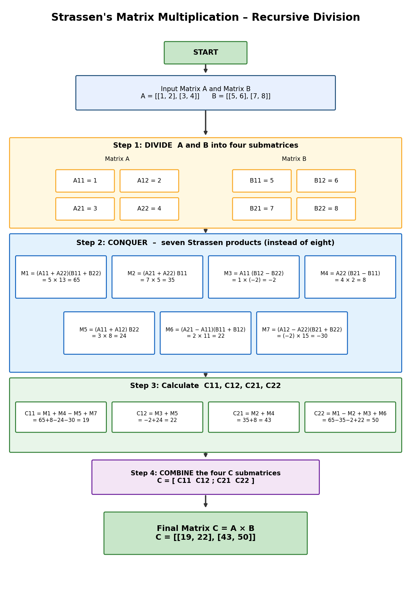
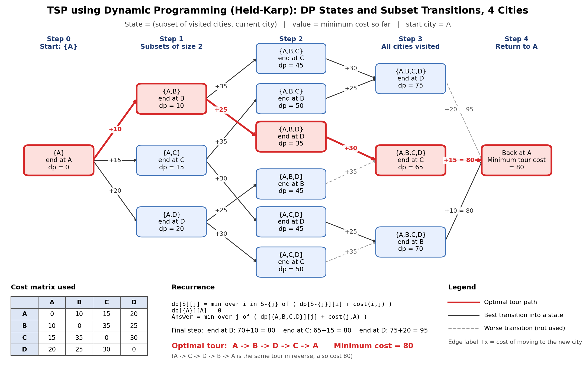
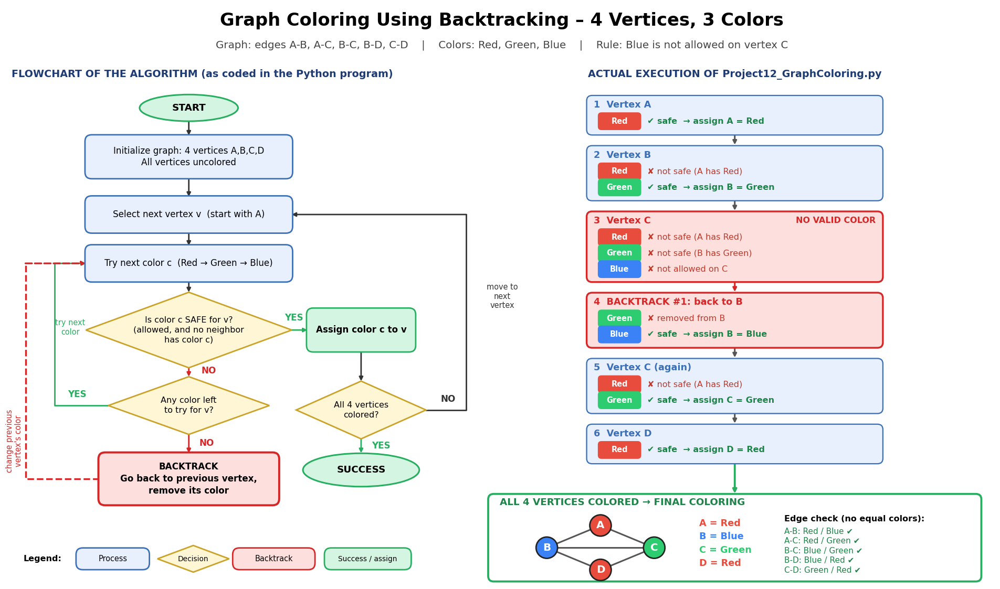

# DAA Macro Project - Group 10

**Course:** Design and Analysis of Algorithms (DAA) | **Group:** G10

This repository holds all five macro projects of Group 10, one from each unit. For every project we wrote the algorithm, ran the Python program, and used an AI-generated visualization (created from an engineered prompt) to show how the algorithm works.

## Projects

| Unit | Project | Technique | Folder | Result |
|---|---|---|---|---|
| I - Algorithm Analysis | 1. Sorting Complexity Visualizer | Divide and conquer, asymptotic growth | [`Unit1_Algorithm_Analyser`](Unit1_Algorithm_Analyser) | n log2 n = 33 / 664 / 9,966 for n = 10 / 100 / 1000 |
| II - Divide and Conquer | 5. Strassen's Matrix Multiplication | Divide and conquer | [`Unit2_Divide_And_Conquer`](Unit2_Divide_And_Conquer) | 7 products instead of 8; C = [[19, 22], [43, 50]] |
| III - Dynamic Programming | 7. Traveling Salesperson DP Table | Held-Karp DP | [`Unit3_Dynamic_Programming`](Unit3_Dynamic_Programming) | Minimum cost 80, tour A > B > D > C > A |
| IV - Backtracking | 12. Graph Coloring Backtracking Flow | Backtracking | [`Unit4_BackTracking`](Unit4_BackTracking) | 1 backtrack; A = Red, B = Blue, C = Green, D = Red |
| V - Branch and Bound | 14. TSP Branch-and-Bound Search Tree | Branch and bound | [`Unit5_ Branch and Bound`](<Unit5_ Branch and Bound>) | 11 nodes, 5 pruned; optimal cost 80 |

Each unit folder contains the code, `Prompt.txt`, `Visualization.png` and its own `README.md` with pseudocode and complexity analysis. The presentation is in [`PPT/Group10_DAA_Macro_Project.pptx`](PPT/Group10_DAA_Macro_Project.pptx).

## How each project was built

1. Write the algorithm / pseudocode.
2. Expand the faculty prompt with the exact data (matrices, graphs, costs).
3. Generate the visualization with AI.
4. Run the program and check that the picture matches its output.
5. Document it with a README.

---

## Unit I - Project 1: Sorting Complexity Visualizer

**Faculty prompt:** "Generate a graph comparing time complexity of Merge, and Quick Sort for n = 10, 100, 1000."

Theoretical growth n log2(n) is plotted for Merge Sort and Quick Sort (average case). The two lines overlap because both are O(n log n) on average; Quick Sort's worst case is O(n²). No execution times are measured.

**Visualization**


**Program output (`python SortingComplexity.py`)**


---

## Unit II - Project 5: Strassen's Matrix Multiplication

**Faculty prompt:** "Illustrate recursive division of matrices in Strassen's algorithm."

Each matrix is divided into four quadrants. Strassen computes seven products M1 to M7 (instead of eight), builds C11, C12, C21, C22 from them, and combines these into the result. Time is O(n^2.81) versus O(n³) for the standard method. Example: A = [[1, 2], [3, 4]], B = [[5, 6], [7, 8]] gives C = [[19, 22], [43, 50]].

**Visualization**



**Program output (`python Project5_Strassen.py`)**


The program checks its result against ordinary multiplication and prints `Both results equal: True`.

---

## Unit III - Project 7: Traveling Salesperson using Dynamic Programming

**Faculty prompt:** "Visualize DP state transitions for TSP with 4 cities."

Held-Karp DP stores `dp[subset][current city]`, the minimum cost to start at A, visit exactly that subset and end at that city. Subsets are processed from small to large, then the tour closes by returning to A. Time is O(n² 2^n) versus O((n-1)!) for brute force.

| From \ To | A | B | C | D |
|---|---|---|---|---|
| **A** | 0 | 10 | 15 | 20 |
| **B** | 10 | 0 | 35 | 25 |
| **C** | 15 | 35 | 0 | 30 |
| **D** | 20 | 25 | 30 | 0 |

**Visualization** (red = optimal path, dashed grey = worse transitions)



**Program output (`python Project7_TSP_DP.py`)**


**Result:** optimal tour A > B > D > C > A with minimum cost 80.

---

## Unit IV - Project 12: Graph Coloring using Backtracking

**Faculty prompt:** "Illustrate backtracking steps for coloring a 4-vertex graph using 3 colors."

Graph edges: A-B, A-C, B-C, B-D, C-D. Colors are tried in the order Red, Green, Blue. To make backtracking actually happen, the program adds one rule: **Blue is not allowed on vertex C** (without it, first-fit coloring finds the answer with no backtrack). Run: A = Red, B = Green, then C has no valid color, so the algorithm **backtracks to B**, changes it to Blue, and finishes with C = Green, D = Red. Worst-case time is O(M^V).

**Visualization** (left: algorithm flowchart, right: actual run)



**Program output (`python Project12_GraphColoring.py`)**


---

## Unit V - Project 14: TSP Branch-and-Bound Search Tree

**Faculty prompt:** "Draw a search tree showing bounding and pruning for TSP with 4 cities."

Each node is a partial tour with a lower bound: `LB = g + cheapest edge leaving the last city + sum of the cheapest edge leaving each unvisited city`. After the first complete tour (cost 80) is found, every node with LB >= 80 is pruned. The search created 11 nodes and pruned 5; only 1 of the 6 possible tours was generated. The result is verified against a brute-force check inside the program.

**Visualization** (blue = expanded, red dashed = pruned, green = optimal)


**Program output (`python Project14_TSP_BnB.py`)**


---

## Repository structure

```
DAA-Macro-Project-Group10/
├── README.md
├── Output_Screenshots/
├── Unit1_Algorithm_Analyser/
├── Unit2_Divide_And_Conquer/
├── Unit3_Dynamic_Programming/
├── Unit4_BackTracking/
├── Unit5_ Branch and Bound/
└── PPT/
    └── Group10_DAA_Macro_Project.pptx
```

## How to run

Python 3 and `matplotlib` are needed (`pip install matplotlib`; Unit 1 also uses `mplcursors`).

```
python Unit1_Algorithm_Analyser/SortingComplexity.py
python Unit2_Divide_And_Conquer/Project5_Strassen.py
python Unit3_Dynamic_Programming/Project7_TSP_DP.py
python Unit4_BackTracking/Project12_GraphColoring.py
python "Unit5_ Branch and Bound/Project14_TSP_BnB.py"
```

## Learning outcomes

- Chose and applied the right technique for each problem: divide and conquer, DP, backtracking, branch and bound.
- Understood how pruning (backtracking and bounding) avoids useless work.
- Learned prompt-based visualization and checked AI-generated diagrams against real program output.
- Practiced GitHub documentation.
