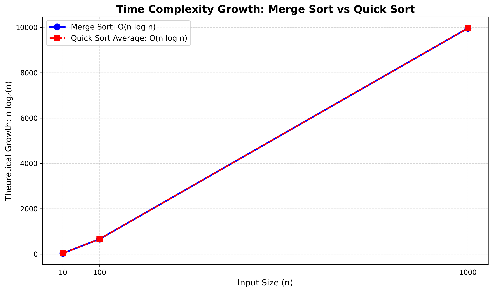

# Sorting Complexity Visualizer (Merge Sort vs Quick Sort)

**DAA Macro Project | Group G10 | Unit I - Algorithm Analysis | Project 1**

## Description

Merge Sort and Quick Sort are both divide-and-conquer sorting algorithms. This project compares their **theoretical** time-complexity growth for n = 10, 100 and 1000 using the function n log2(n), and shows it as a line chart. Actual execution times are not measured.

## Algorithm

**Merge Sort**

```
MERGE_SORT(array):
    if array has 0 or 1 element: return it
    find the middle position
    divide the array into left and right halves
    recursively MERGE_SORT both halves
    merge the two sorted halves
    return the sorted array
```

**Quick Sort**

```
QUICK_SORT(array, low, high):
    if low < high:
        select a pivot and partition the array
        place the pivot in its correct position
        QUICK_SORT(left part)
        QUICK_SORT(right part)
```

| Algorithm | Best | Average | Worst |
|---|---|---|---|
| Merge Sort | O(n log n) | O(n log n) | O(n log n) |
| Quick Sort | O(n log n) | O(n log n) | O(n²) |

## Prompt Used

"Create a clear line chart comparing the theoretical time complexity growth of Merge Sort and Quick Sort for input sizes n = 10, 100, and 1000. Use n log2(n) as the theoretical growth function..." (full prompt in `Prompt.txt`)

## Output



Theoretical growth values printed by `SortingComplexity.py`:

| n | n log2(n) |
|---|---|
| 10 | 33.22 |
| 100 | 664.39 |
| 1000 | 9965.78 |

The X-axis is the input size and the Y-axis is n log2(n). The two lines overlap because both algorithms have the same average-case growth rate, O(n log n). Quick Sort's worst case, O(n²), is not drawn.

## Learning Outcome

- Understood best, average and worst-case time complexity.
- Compared Merge Sort and Quick Sort growth.
- Learned prompt-based visualization.
- Practiced GitHub documentation.

## Files

| File | Purpose |
|---|---|
| `SortingComplexity.py` | Prints the growth values and complexity table, draws the chart |
| `Prompt.txt` | Faculty prompt and expanded visualization prompt |
| `Visualization.png` | Line chart |
| `README.md` | This file |

Run with: `python SortingComplexity.py` (needs `matplotlib` and `mplcursors`).
